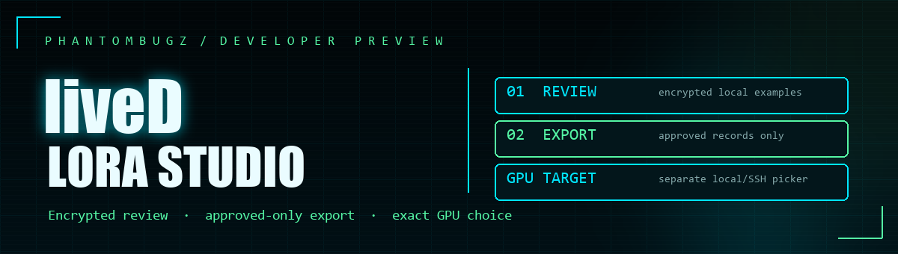
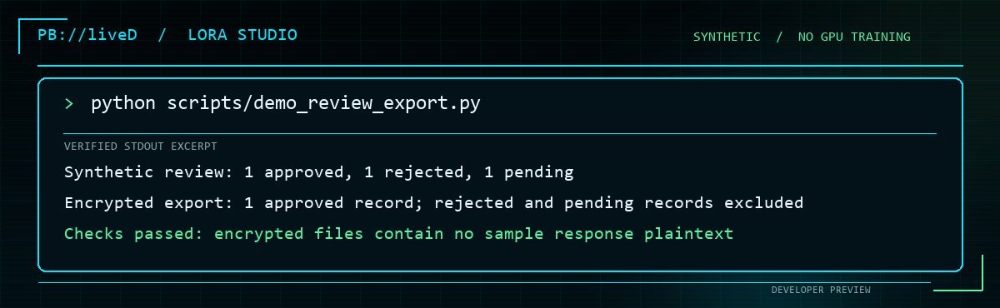
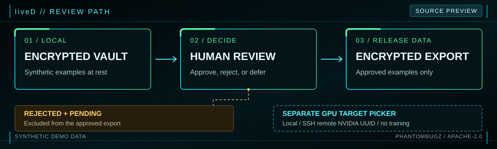
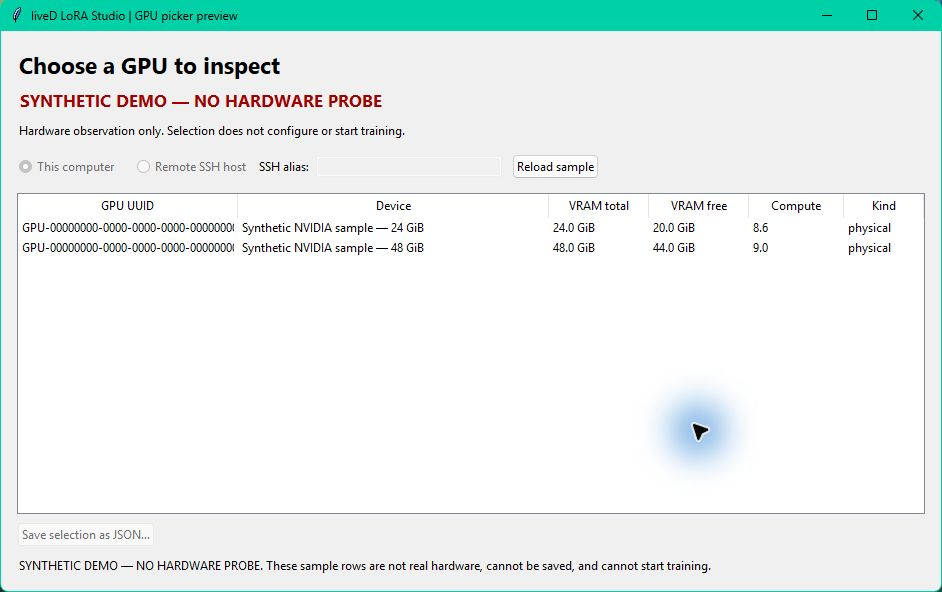

# liveD LoRA Studio



**Developer preview · Apache-2.0**

[](https://github.com/PhantomBugz/lived-lora-studio/actions/workflows/source-smoke.yml)

liveD LoRA Studio is a workbench for preparing technical examples for model adaptation. This preview lets developers inspect a real slice of its local workflow: encrypted storage, explicit human review, and an encrypted export containing only approved examples. It also introduces a target picker for a specific NVIDIA GPU on a local or remote machine.

The source preview is intentionally small. It does not ship the full desktop application, a model trainer, an installer, or a trained model. A selected GPU is an observed target until its CUDA runtime and a training recipe have passed separate checks. See [release status](docs/STATUS.md).

## Try the review and export demo

Install Python 3.12, then run one command from the repository root:

```shell
python scripts/quickstart_preview.py
```

The command creates `.venv-preview`, installs the pinned `cryptography` dependency from PyPI, and runs an original synthetic example. It needs no account, browser, model download, GPU, or liveD server. It prints a short approved record after decrypting its disposable output in memory:

```text
Synthetic review: 1 approved, 1 rejected, 1 pending
Encrypted export: 1 approved record; rejected and pending records excluded
Checks passed: encrypted files contain no sample response plaintext
```

The demo checks those claims as it runs and removes its temporary workspace afterward. [Read the walkthrough](docs/DEMO.md).

<picture>
  <source media="(prefers-reduced-motion: no-preference)" srcset="docs/assets/lived-demo-terminal.gif">
  
</picture>

*Synthetic demo output. The animation reveals the three verified status lines; the static image is used when reduced motion is preferred.*



*Synthetic preview workflow. [PNG version](docs/assets/lived-pipeline.png).*

The GPU selection path is separate from the review/export demo. A future training runtime will join them only after its approval and execution checks pass.

## Choose a GPU target

The picker discovers NVIDIA devices by UUID and lets you choose one exact GPU on either the local machine or a remote Linux machine reached through an existing SSH alias. It reports the observed name, VRAM, compute capability, and driver. Discovery and selection do not start a training run or transfer a dataset. Remote discovery requires your own SSH setup and strict host-key verification.

```shell
python scripts/select_gpu.py list
python scripts/select_gpu.py list --remote SSH_ALIAS
python scripts/select_gpu.py choose --gpu GPU-UUID --output selected-gpu.json
python scripts/select_gpu.py refresh --selection selected-gpu.json
```

The optional desktop picker opens with `python scripts/select_gpu_gui.py`. On a computer without an NVIDIA GPU, `python scripts/select_gpu_gui.py --synthetic-demo` shows clearly labeled sample devices and disables saving. See [GPU target selection](docs/GPU-TARGETS.md) for the exact commands, support boundaries, and the distinction between a visible device and a qualified training runtime.



*Synthetic picker UI example. The device rows are fictitious; no hardware or SSH host was probed and saving is disabled.*

## What is in this preview

| Component | Current state |
| --- | --- |
| Local vault, review decisions, encrypted approved-only export | Runnable synthetic demo on Python 3.12 |
| Local and remote NVIDIA GPU discovery/selection | CLI and standalone picker implemented; 24 focused tests passed with synthetic inventories. No live remote GPU was checked. |
| CUDA/LoRA training on a selected GPU | Not released or verified |
| Full Studio GUI and platform installers | Not included in this source preview |

The broader Studio design places source capture before review and keeps data selection under operator control. The preview exercises the review/export path using a locally authored fixture. It does not access an external site or establish that a particular model or GPU can train on a particular dataset.

## Develop and contribute

Run the demo above, then use [CONTRIBUTING.md](CONTRIBUTING.md) for focused tests and a minimal bug report. Use only sources you are authorized to collect. Keep credentials, browser profiles, private vaults, captured pages, and real training records out of issues and pull requests; synthetic fixtures are preferred.

Code is licensed under [Apache-2.0](LICENSE). This preview carries no bundled model weights.

## PhantomBugz projects

- [PhantomBugz](https://github.com/PhantomBugz) — project updates and source repositories.
- [Aftershock](https://github.com/PhantomBugz/aftershock) — open-source incident response work.
- [Zombie Killer](https://phantombugz.com/zombie-killer.html) — project preview; public source and release are pending.
